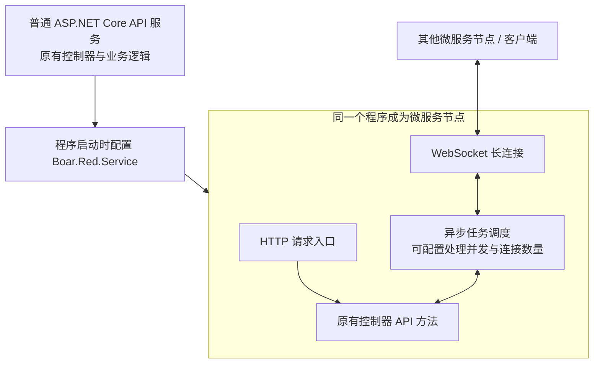

# Boar.Red.Service

[](LICENSE)
[](https://dotnet.microsoft.com/)

`Boar.Red.Service` 是 Boar.Red 微服务框架的核心库。普通 ASP.NET Core API 服务只需在程序启动时完成框架配置，就能成为微服务节点；默认配置下，原有控制器的所有 API 方法都可通过微服务框架访问，业务代码保持原样，节点化的改造成本几乎为零。底层以异步任务组织请求处理，配合 WebSocket 长连接传输，构建资源可控、性能高效的服务网络。

`Boar.Red.Service` is the core library of the Boar.Red microservice framework. An ordinary ASP.NET Core API service becomes a microservice node through startup configuration. By default, all existing controller API actions are accessible through the framework, keeping business code intact and integration effort close to zero. Asynchronous task processing and persistent WebSocket connections form a resource-controlled, efficient service network.

---

## 特性

- **非侵入式接入**：现有 ASP.NET Core 程序无需改动任何业务代码，只要在启动阶段完成 `Boar.Red.Service` 的配置（或直接使用框架提供的 `RunWithServerName` 启动方法），当前项目即可成为一个完整的微服务节点——自动注册到服务管理器、接受网关路由、与其他服务互相调用。
- **服务注册与发现**：内置 `ServiceDiscoverer`，通过服务管理器（Boar.Red.ServiceManager）完成节点注册、状态上报与节点发现。
- **控制器直接接入**：默认将现有控制器的所有 API 方法纳入微服务请求分发，同一套控制器可继续提供 HTTP 接口，并接受其他节点通过框架发起的调用。
- **异步服务网络**：请求发送、接收与处理由异步任务调度，复用 WebSocket 长连接；通过并发与连接数量配置控制资源使用，数据包支持压缩与 AES 加密。
- **统一请求管道**：跨域控制、请求体大小限制、Token 校验过滤器、请求合法性校验过滤器、管理员登录会话等开箱即用。
- **配置驱动**：`ConfigFiles/ServiceConfig.json`（带注释的 JSONC）集中管理 Web 服务、微服务、管理员等全部配置；日志统一写入 `LogFiles/`。
- **多宿主支持**：同一套代码可运行在 Kestrel 或 IIS 上（通过构建配置切换）。

## Features

- **Non-intrusive integration**: no business code changes are required. Any existing ASP.NET Core app becomes a full microservice node — registering to the service manager, being routed by the gateway, and calling other services — just by completing the `Boar.Red.Service` setup at startup, or by using the framework's `RunWithServerName` host method.
- **Service registration & discovery**: built-in `ServiceDiscoverer` handles node registration, state reporting and discovery via Boar.Red.ServiceManager.
- **Controller integration**: existing controller API actions are included in microservice request dispatch by default. The same controllers continue to serve HTTP requests and calls from other nodes through the framework.
- **Asynchronous service network**: asynchronous tasks coordinate sending, receiving and processing over persistent WebSocket connections. Configurable concurrency and connection limits control resource use; packets support compression and AES encryption.
- **Unified request pipe**: cross-domain control, request body size limit, token checker filter, request validator filter and administrator session — all included.
- **Configuration driven**: all settings live in `ConfigFiles/ServiceConfig.json` (commented JSONC); logs are written to `LogFiles/`.
- **Multiple hosts**: the same code runs on Kestrel or IIS, switchable via build configurations.

---

## 非侵入式接入 / Non-intrusive Integration

这是 Boar.Red 框架最核心的设计目标：**把一个现有项目变成微服务节点，成本只在启动阶段**。

This is the framework's central design goal: turning an existing project into a microservice node costs nothing beyond the startup stage.

接入前，你的项目就是一个普通的 ASP.NET Core 程序：

Before, your project is an ordinary ASP.NET Core app:

```csharp
var app = WebApplication.CreateBuilder(args).Build();
app.MapGet("/api/hello", () => "Hello World!");
app.Run();
```

接入后，使用 `RunWithServerName` 统一创建并运行宿主，在 `toConfigureRequestPipeTrailer` 回调中注册原有业务路由。该方法内部已经调用 `Build()` 和 `Run()`，调用后无需再创建或运行一次应用。

Use `RunWithServerName` to build and run the host, and register existing business routes in `toConfigureRequestPipeTrailer`. The method already calls `Build()` and `Run()` internally.

下面展示启动代码的接入结构；`Config`、`Log`、`AESKeys` 和 `ServiceConfig` 为项目自己的配置与日志对象，完整实现见下方 MVC 示例。`toConfigureService` 中继续保留业务项目已有的依赖注册。

This startup example assumes the app already defines its configuration and logging objects. See the MVC example below for their implementations; keep existing dependency registrations in `toConfigureService`.

```csharp
using Boar.Red.Service.BrService;
using Boar.Red.Service.BrService.ViewModels;
using Boar.Red.Service.Constants;
using Boar.Red.Service.Extensions;
using System.Reflection;
// 同时引入当前项目中 Config、ServiceConfig、Log 和 AESKeys 所在的命名空间。
// Also import your app's configuration, logging and AESKeys namespaces.

var appBuilder = WebApplication.CreateBuilder(args);

appBuilder.RunWithServerName(
    "My Server",
    BaoXia.Utils.Environment.GetEnvironmentNameWith_ASPNETCORE_ENVIRONMENT(),
    Assembly.GetExecutingAssembly(),
    HttpServer.Kestrel,
    AESKeys.Default,
    "ConfigFiles", "LogFiles",
    Log.Logs, Log.Exception, Log.Warning, Log.BrService,
    Config.Service, nameof(ServiceConfig.WebServiceConfig),
    RouteTemplateConstants.RouteTemplatesDefault,
    new ServiceInitializationParam(
        Config.Service, nameof(ServiceConfig.WebServiceConfig),
        Config.Service, nameof(ServiceConfig.BrServiceConfig),
        serviceDiscoverSpecified: new ServiceDiscoverer()),
    new ServiceAdministratorInitializationParam(
        Config.Service, nameof(ServiceConfig.ServiceAdministratorConfig)),
    toConfigureService: builder =>
    {
        // 在此保留原项目的服务注册，例如 builder.Services.AddDbContext(...)。
        // Keep your existing service registrations here.
        return builder;
    },
    toConfigureRequestPipeTrailer: app =>
    {
        app.MapGet("/api/hello", () => "Hello World!");
        return app;
    });
```

完成这一步后，你的项目即获得：向服务管理器注册、上报运行状态、接受网关按规则路由、通过服务发现调用其他微服务等能力。

Your app now registers to the service manager, reports its state, receives gateway routing, and can discover & call other microservices.

> 完整可运行示例见 [`Boar.Red.Service.Test.NetCoreMvc`](Boar.Red.Service.Test.NetCoreMvc)（一个接入了微服务能力的模板项目）。
> A complete runnable example lives in [`Boar.Red.Service.Test.NetCoreMvc`](Boar.Red.Service.Test.NetCoreMvc).

---

## 框架设计 / Framework Design

`Boar.Red.Service` 的核心设计，是让**微服务能力在程序启动阶段接入，让原有控制器继续承载业务**。一个普通 API 服务完成启动配置后，就成为服务网络中的节点，能够被其他节点发现和调用。改造工作集中在启动入口，原有控制器、业务方法与依赖注入可以继续复用，因此普通服务变成微服务节点的成本几乎为零。

The core design attaches microservice capabilities at application startup while keeping existing controllers responsible for business logic. Once configured, an ordinary API service becomes a node that other nodes can discover and call. Startup configuration is the main integration work; controllers, business methods and dependency injection remain reusable, bringing migration effort close to zero.



### 启动配置即接入 / Integration at Startup

在程序启动时配置框架的服务注册、请求管道和节点通信参数，或使用 `RunWithServerName` 完成这些初始化，既有 API 程序即可获得服务注册与发现、节点通信和请求分发能力。业务实现继续留在原来的控制器和服务中，接入过程主要是为已有程序增加节点能力。

Configure the framework's service registration, request pipeline and node communication at startup, or use `RunWithServerName` to initialize them. The existing application gains service registration and discovery, node communication and request dispatch, while business implementations stay in their original controllers and services.

### 原有控制器就是微服务入口 / Existing Controllers as Service Entry Points

默认配置下，**现有控制器的所有 API 方法都可以通过微服务框架访问**。框架将来自 WebSocket 长连接的请求分发到对应的控制器方法，同一套业务接口同时服务原有 HTTP 调用和微服务网络中的调用，保持统一的业务实现。

这一行为由初始化参数 `IsControllerBrServiceDefault` 控制，默认值为 `true`；原有 HTTP 入口也默认保留。因此，节点化接入不需要为微服务调用再编写一套控制器接口。

By default, **all existing controller API actions are accessible through the microservice framework**. Requests arriving over WebSocket connections are dispatched to their matching controller actions, so HTTP callers and microservice callers use the same business implementation. `IsControllerBrServiceDefault` is `true` by default, and HTTP access remains enabled by default.

### 异步任务与长连接协同 / Asynchronous Tasks and Persistent Connections

底层将请求发送、接收与处理组织为异步任务，通过 WebSocket 长连接在节点间双向传输请求和响应，让任务调度、并发控制与连接复用协同工作，形成资源可控、性能高效的服务网络。

- **异步任务调度**：以异步方式衔接网络 I/O 与请求处理，减少等待网络数据时对执行线程的持续占用。
- **长连接复用**：复用节点之间已经建立的 WebSocket 连接，减少重复建连与握手的开销，持续承载服务调用。
- **并发资源可配置**：按服务负载与可用资源设置请求处理并发、响应处理并发和连接数量，控制同时进行的任务规模。

At the transport and processing layers, asynchronous tasks coordinate request sending, receiving and execution over bidirectional WebSocket connections. Asynchronous I/O reduces thread occupation during network waits, persistent connections reduce repeated connection setup, and configurable request processing, response processing and connection limits let applications tune concurrency to their available resources.

---

## 相关仓库 / Related Repositories

`Boar.Red.Service` 提供应用接入服务网络的基础能力；服务管理器、网关与缓存则是基于该框架构建的配套项目。

`Boar.Red.Service` supplies the foundation for joining the service network. The service manager, gateway and cache are companion projects built on that framework.

| 仓库 / Repository | 说明 / Description |
| --- | --- |
| [Boar.Red.Service](https://github.com/Boar-Red/Boar.Red.Service) | 核心库（本仓库），打 NuGet 包 / core library (this repo), published as a NuGet package |
| [Boar.Red.ServiceManager](https://github.com/Boar-Red/Boar.Red.ServiceManager) | 服务管理器：注册中心 + 管理后台 / service manager: registry + admin console |
| [Boar.Red.Gateway](https://github.com/Boar-Red/Boar.Red.Gateway) | 网关服务 / gateway service |
| [Boar.Red.Cache](https://github.com/Boar-Red/Boar.Red.Cache) | 缓存服务及客户端 / cache service and its client |
| [Boar.Red.Services](https://github.com/Boar-Red/Boar.Red.Services) | 聚合解决方案（开发用）/ aggregate solution (for development) |

---

## 快速开始 / Quick Start

### 方式一：NuGet 引用（业务接入）/ Option A: NuGet (for business integration)

只想把现有项目接入微服务能力，直接安装包即可：

To add microservice capabilities to an existing project, just install the package:

```bash
dotnet add package Boar.Red.Service
```

### 方式二：源码编译（参与开发）/ Option B: build from source (for development)

本仓库单独 clone 后可编译核心库；但要运行完整服务（管理器、网关、缓存），需要按**兄弟目录**布局把相关仓库 clone 到同一级目录：

This repo can be cloned and built alone, but running the full services requires the **sibling-directory** layout:

```bash
git clone https://github.com/Boar-Red/Boar.Red.Service
git clone https://github.com/Boar-Red/Boar.Red.ServiceManager
git clone https://github.com/Boar-Red/Boar.Red.Gateway
git clone https://github.com/Boar-Red/Boar.Red.Cache
```

> ⚠️ 各仓库之间使用相对路径的项目引用，**目录名必须保持不变**，否则编译时找不到引用。
> ⚠️ The repos reference each other by relative paths — **do not rename the directories**, or the project references will break.

环境要求 / Requirements：.NET 10 SDK。

```bash
cd Boar.Red.Service
dotnet build Boar.Red.Service.slnx
```

---

## 配置说明 / Configuration

所有配置位于 `ConfigFiles/ServiceConfig.json`（支持 `//` 注释的 JSONC 格式），顶层配置节：

All settings live in `ConfigFiles/ServiceConfig.json` (JSONC with `//` comments). Top-level sections:

| 配置节 / Section | 说明 / Description |
| --- | --- |
| `ServiceAdministratorConfig` | 服务管理员账号（登录管理后台用）/ administrator accounts for the admin console |
| `WebServiceConfig` | Web 宿主：IP、端口、HTTPS 证书、跨域等 / web host: IP, ports, HTTPS certificates, CORS |
| `BrServiceConfig` | 微服务：服务发现地址、数据包压缩/加密、心跳等 / microservice: discovery address, packet compression/encryption, heartbeat |
| （各服务扩展节） | 具体服务自有的扩展配置 / service-specific extension sections |

> ⚠️ 配置文件中的账号、密码与 AES 密钥均为**本地示例值**，部署时必须全部更换。
> ⚠️ All accounts, passwords and AES keys in the sample configs are **local examples only** and MUST be replaced in production.

---

## 文档 / Documents

- [安全关机（Safe Shutdown）](Boar.Red.Service/Documents/安全关机.md) —— 客户端与服务端的安全关机握手流程 / safe shutdown handshake between clients and servers.

---

## 自动检查 / Automated Checks

每次提交和 Pull Request 的构建、测试、依赖审计及更新方式见 [CI 说明](docs/ci.md)。

See [CI and dependency updates](docs/ci.md) for automated build, test and dependency checks.

## 许可证 / License

本项目采用 [MIT License](LICENSE) 开源，Copyright © 2026 Boar.Red。

This project is open-sourced under the [MIT License](LICENSE), Copyright © 2026 Boar.Red.
